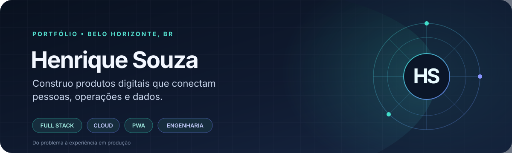

<div align="center">
  
</div>

<div align="center">

[Portfólio](https://henriquesouzas.com/) · [LinkedIn](https://www.linkedin.com/in/henrique-s-4080b9139/) · [Projetos](#projetos) · [Contato](mailto:henriquesouza1832001@gmail.com)

</div>

---

## O que me move

Sou desenvolvedor full stack em Belo Horizonte. Gosto de pegar problemas que estão espalhados entre planilhas, mensagens e processos manuais e transformá-los em sistemas que façam sentido para quem usa.

Minha experiência vem de construir de ponta a ponta: entender o contexto, desenhar a solução, cuidar da interface, das regras e dos dados, integrar serviços e acompanhar o produto depois que ele vai ao ar. Também desenvolvo ferramentas ligadas à engenharia e à construção civil — uma área que me ajuda a manter os pés no chão e pensar em como o software entra no trabalho real.

Os projetos abaixo passam por obras, manutenção, experiências pela cidade, plataformas sociais e simulações. Cada um pede uma combinação diferente de tecnologia; é isso que deixa o processo interessante.

## Projetos

### Engenharia e operações

#### [ObraPro](https://github.com/henriquesouza1832001-eng/ObraPro) · [Preview](https://obrapro-preview.henriquesouza.workers.dev)

Uma plataforma web/PWA para aprender, planejar e acompanhar obras. Reúne catálogo de cursos, organizações, obras e operações em uma base modular, com autenticação e APIs privadas preparadas para separar os dados por organização.

**PWA · Cloudflare Workers · D1 · TypeScript · GitHub Actions**

#### [Controler — Labs & Tracks](https://github.com/henriquesouza1832001-eng/condrio)

ERP operacional que nasceu de uma necessidade prática: acompanhar obras, manutenção, climatização, acesso e atividades do time sem depender de planilhas e conversas dispersas. Tem módulos de obras, chamados, conforto, controle de acesso, CAPEX e indicadores.

**Python · FastAPI · Databricks Apps · Delta Lake · HTML/CSS/JavaScript**

#### [Dashboard Labs & Tracks](https://github.com/henriquesouza1832001-eng/dashboard-labs-and-tracks)

Interfaces e painéis para organizar indicadores e rotinas operacionais.

**JavaScript · HTML · CSS**

### Cidade, encontros e experiências

#### [Rota di Buteco 2026](https://github.com/henriquesouza1832001-eng/rotadibuteco) · [Aplicação](https://rotadibuteco.web.app/)

PWA social feita para acompanhar o Comida di Buteco em Belo Horizonte. O roteiro reuniu 128 bares, check-ins com foto, grupos, feed, mapa e nove categorias de ranking em tempo real. O evento terminou; os dados do projeto foram preservados.

**JavaScript · Firebase Authentication · Firestore · Storage · Leaflet · PWA**

#### [Trilha BH](https://github.com/henriquesouza1832001-eng/trilhaBH)

Uma experiência colaborativa para descobrir bares e explorar Belo Horizonte. Junta mapa, visitas, grupos, avaliações e elementos de jogo como desafios, XP e emblemas; também foi preparada como PWA e para Android com Capacitor.

**JavaScript · Firebase · Firestore · Leaflet · Capacitor · PWA**

#### [Quarta é Dia de Amstel](https://github.com/henriquesouza1832001-eng/quarta-amstel)

PWA para descoberta de estabelecimentos e campanhas, com localização, painel administrativo e notificações.

**JavaScript · Cloudflare Workers · D1 · KV · Web Push**

#### [Tudo Começou de um Sim](https://github.com/henriquesouza1832001-eng/tudocomecoudeumsim)

Plataforma para casais montarem o site do casamento e organizarem convites, convidados, eventos e confirmações. O fluxo inclui áreas diferentes para o casal, convidados, padrinhos e equipe do evento.

**React · Cloudflare Pages · Workers · D1 · R2**

### Dados e simulações

#### [CORVO](https://github.com/henriquesouza1832001-eng/Corvo)

Sistema que acompanha fontes públicas, filtra notícias que podem afetar mercados e registra evidências para análise. A etapa preditiva está em desenvolvimento: as previsões precisam ser conferidas e calibradas antes de serem apresentadas.

**Python · Cloudflare Workers · Turso · feeds públicos**

#### [Civiciclo](https://github.com/henriquesouza1832001-eng/simulator-election-brazil-) · [Protótipo](https://d2dpmk0vrt66wn.cloudfront.net)

Simulador político fictício jogado no navegador. Decisões, campanhas, eleições e projetos mudam o estado da partida; as regras são abstrações de jogo, não previsões sobre a política real.

**Python · React · SQLite · simulação determinística**

## Ferramentas que uso

<div align="center">
  
</div>

**Interface e produto:** aplicações responsivas, mobile-first, PWAs, Service Workers, mapas, geolocalização e painéis administrativos.  
**Backend e dados:** APIs REST, autenticação, permissões, SQL, Firestore, D1, integrações e dados em tempo real.  
**Entrega:** Git, GitHub Actions, CI/CD, documentação técnica, testes e evolução incremental.

## Como costumo trabalhar

```text
ENTENDER O CONTEXTO → DESENHAR O FLUXO → CONSTRUIR O SISTEMA
          → COLOCAR EM USO → APRENDER COM O QUE ACONTECE
```

A tecnologia vem depois da necessidade. Um feed social pede atualizações em tempo real; uma ferramenta operacional pede rastreabilidade; uma PWA precisa funcionar bem no celular. Procuro deixar essas escolhas visíveis no produto, em vez de adicionar complexidade sem motivo.

## Atividade no GitHub

<div align="center">
  
  
</div>

<div align="center">
  
</div>

*Os cartões e o gráfico são carregados dinamicamente por serviços externos e refletem os dados públicos do GitHub.*

---

<div align="center">

**Quer conversar sobre um produto ou problema interessante?**  
[LinkedIn](https://www.linkedin.com/in/henrique-s-4080b9139/) · [E-mail](mailto:henriquesouza1832001@gmail.com)

</div>
