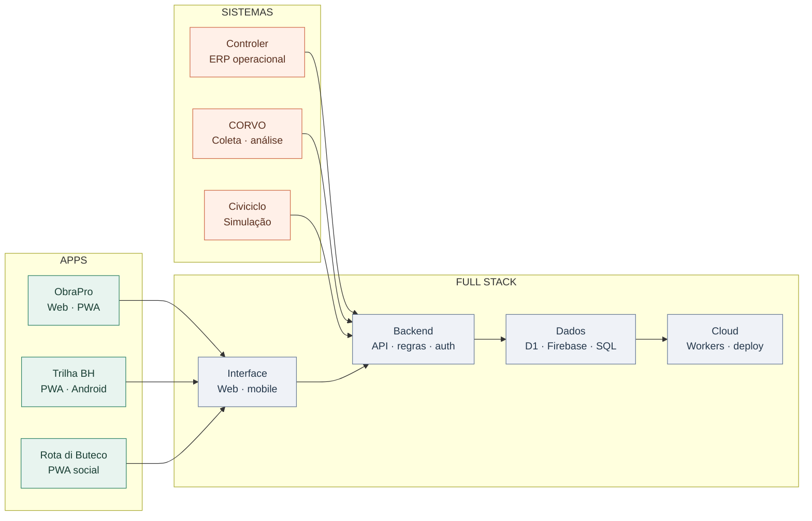

# Henrique Souza

[LinkedIn](https://www.linkedin.com/in/henrique-s-4080b9139/)　·　[E-mail](mailto:henriquesouza1832001@gmail.com)　·　[Todos os repositórios](https://github.com/henriquesouza1832001-eng?tab=repositories)

---

## Apps e sistemas, da tela ao servidor

Sou desenvolvedor full stack em Belo Horizonte, com experiência em software e engenharia. Construo aplicações web, PWAs e sistemas operacionais completos: interface, regras de negócio, APIs, autenticação, dados, integrações e deploy.

Gosto de entender o processo antes de escolher a tecnologia. Por isso, meus projetos passam de ferramentas para obras e manutenção a apps para explorar a cidade, plataformas sociais e produtos digitais.

  　　

Produtos que estou construindo: gestão de obras · descoberta pela cidade · experiências locais

### O que existe por trás de cada app

## Projetos

### Apps e produtos digitais

#### [ObraPro](https://github.com/henriquesouza1832001-eng/ObraPro) · [Abrir preview](https://obrapro-preview.henriquesouza.workers.dev)

Plataforma web/PWA para aprender, planejar e acompanhar obras. Reúne catálogo de cursos, organizações, obras e operações, com autenticação, papéis e APIs privadas.

`TypeScript` `PWA` `Cloudflare Workers` `D1` `GitHub Actions`

#### [Trilha BH](https://github.com/henriquesouza1832001-eng/trilhaBH)

App colaborativo para descobrir bares e experiências em Belo Horizonte: mapa, avaliações, grupos, rotas, desafios, XP e emblemas. Preparado como PWA e para Android com Capacitor.

`JavaScript` `Firebase` `Firestore` `Leaflet` `Capacitor`

#### [Rota di Buteco 2026](https://github.com/henriquesouza1832001-eng/rotadibuteco) · [Abrir app](https://rotadibuteco.web.app/)

PWA social feita para o Comida di Buteco em BH. A jornada reuniu 128 bares, check-ins por foto, grupos, feed, mapa e nove rankings em tempo real. O evento terminou e os dados foram preservados.

`Firebase Auth` `Firestore` `Storage` `Leaflet` `PWA`

#### [Quarta é Dia de Amstel](https://github.com/henriquesouza1832001-eng/quarta-amstel)

App de localização e descoberta de estabelecimentos, campanhas, painel administrativo e notificações Web Push.

`JavaScript` `Cloudflare Workers` `D1` `KV` `Web Push`

#### [Tudo Começou de um Sim](https://github.com/henriquesouza1832001-eng/tudocomecoudeumsim)

Produto para casais criarem o site do casamento e organizarem convites, convidados, eventos e confirmações. Cada perfil — casal, convidado, padrinho e equipe — tem um fluxo específico.

`React` `Cloudflare Pages` `Workers` `D1` `R2`

### Sistemas para engenharia e operação

#### [Controler · Labs & Tracks](https://github.com/henriquesouza1832001-eng/condrio)

ERP que reúne obras, manutenção, climatização, controle de acesso, atividades e indicadores. Criado para substituir planilhas e conversas dispersas por fluxos e dados integrados.

`Python` `FastAPI` `Databricks Apps` `Delta Lake` `PWA`

#### [Dashboard Labs & Tracks](https://github.com/henriquesouza1832001-eng/dashboard-labs-and-tracks)

Painéis e interfaces operacionais para acompanhar dados e rotinas de facilities, manutenção e obras.

`JavaScript` `HTML` `CSS`

### Dados e simulação

#### [CORVO](https://github.com/henriquesouza1832001-eng/Corvo)

Coleta notícias de fontes públicas, filtra sinais que podem mexer com mercados e registra evidências. A etapa de previsão está em construção e será avaliada com calibração.

`Python` `Cloudflare Workers` `Turso` `Feeds`

#### [Civiciclo](https://github.com/henriquesouza1832001-eng/simulator-election-brazil-) · [Jogar protótipo](https://d2dpmk0vrt66wn.cloudfront.net)

Simulador político fictício no navegador. Decisões, campanhas, eleições e projetos mudam a partida; as regras são abstrações de jogo, não previsões sobre a política real.

`Python` `React` `SQLite` `Simulação determinística`

---

## Stack de desenvolvimento

  

**Apps:** interfaces responsivas, PWA, Service Workers, mapas, geolocalização, Capacitor e experiência mobile-first.  
**Sistemas:** arquitetura, APIs REST, regras de negócio, autenticação, controle de acesso, dashboards e SQL.  
**Operação:** Firebase, Firestore, Cloudflare Workers, Pages, D1, KV, Web Push, GitHub Actions e CI/CD.

## Atividade e tecnologias

  
  

  

Os cartões consultam os dados públicos do perfil; a proporção de linguagens reflete o tamanho dos arquivos nos repositórios.

---

  <b>Apps e sistemas começam entendendo bem o problema.</b> 
  <a href="mailto:henriquesouza1832001@gmail.com">Vamos conversar</a> · <a href="https://www.linkedin.com/in/henrique-s-4080b9139/">LinkedIn</a>

